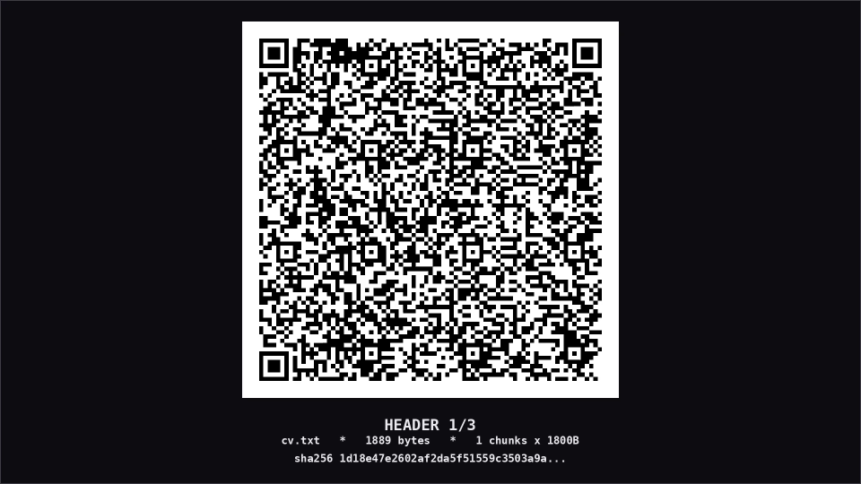

# cv-in-a-video

Store a file inside a video. Upload it to YouTube. Get the file back.

It works. It is also a terrible idea, which is the fun part.



## The trick

```
file -> zlib -> AES-256-GCM -> chunk -> base85 -> QR code -> one video frame
                                                              |
        every frame is independently decodable  <-------------+
```

1. Compress, then encrypt with AES-256-GCM. Key comes from your password via
   PBKDF2-SHA256 (200k iterations). The video is a public envelope; the password
   is the lock.
2. Cut the ciphertext into chunks sized to fit a QR symbol.
3. One frame per chunk: the chunk index in 5 ASCII digits, then the chunk in
   base85. Both go inside a single QR code, with a human-readable caption.
4. Encode as **H.264 all-intra** (`-g 1`, CRF 18). Every frame stands alone,
   so YouTube's transcoder cannot smear data across frames.
5. Upload. Download. Run the decoder. It reads frames with OpenCV, symbols with
   zbar, rebuilds the chunk order, verifies SHA-256 on the ciphertext, decrypts,
   decompresses, and verifies SHA-256 again on the plaintext.

If the hashes match, you got your file back byte for byte. That is the whole
proof — no screenshots required.

## Quickstart

```bash
python3 -m venv .venv
.venv/bin/pip install -r requirements.txt

# zbar is a C library, not a Python package:
#   Debian/Ubuntu: sudo apt install libzbar0
#   macOS:         brew install zbar
#   Arch:          sudo pacman -S zbar

# encode
.venv/bin/python src/make_video.py --in samples/cv.txt --out out/cv-video.mp4 \
    --password 'correct-horse-battery-staple'

# decode
.venv/bin/python src/extract.py --in out/cv-video.mp4 \
    --out out/restored.txt --password 'correct-horse-battery-staple'

# prove it
cmp samples/cv.txt out/restored.txt && echo identical
```

## The honest test

YouTube re-encodes everything. So simulate it before uploading:

```bash
./tools/simulate-youtube.sh out/cv-video.mp4 out/youtube-sim.mp4
.venv/bin/python src/extract.py --in out/youtube-sim.mp4 --out out/restored.txt --password '...'
```

That script downscales to 720p and re-encodes with a normal preset — roughly
what YouTube does to a small channel's upload. If the decode survives that and
the hash matches, the real thing will work too.

## From YouTube

```bash
yt-dlp -f 'bv*[height<=1080]' -o in/youtube.mp4 'https://youtu.be/XXXXXXXXXXX'
.venv/bin/python src/extract.py --in in/youtube.mp4 --out out/restored.txt --password '...'
```

Always grab the **highest quality** stream. Downscaling shrinks QR modules; the
decoder retries at 2x, but you are burning reliability for nothing.

## Numbers

| metric | value |
| --- | --- |
| chunk size | ~1830 B ciphertext (~2290 chars base85) |
| frame rate | 1 fps |
| resolution | 1920x1080 |
| codec | H.264 all-intra, CRF 18 |
| throughput | ~1.8 KB/s of ciphertext -> 6.6 MB/hour of video |
| a 2 KB CV | 1 chunk = 1 frame (+ 3 header frames) |
| a 3 MB random blob | ~1700 frames = ~28 minutes of video |

Absurd throughput. Genuinely robust. That is the trade, and it is the entire
joke: it is the slowest possible backup medium that still technically works.

## Design decisions worth arguing about

**QR codes, not colour grids.** zbar is battle-tested, has Reed-Solomon built
in, and shrugs off scaling, blur and JPEG ringing. A hand-rolled colour grid is
faster and falls apart on the first re-encode.

**base85, not raw bytes.** This one cost an hour of debugging. zbar returns
decoded data as a UTF-8 string; ciphertext is binary and full of bytes that do
not survive that. Base85 costs 25% but never has this problem.

**1 fps.** A frame is either readable or it isn't. Nobody watches this at
30 fps; 1 fps also makes every frame a keyframe for free.

**All-intra H.264.** Deliberately wasteful. In a normal video, a P-frame can be
useless on its own, and YouTube's re-encode makes that worse. `-g 1` removes
the entire class of problem.

**The header repeats.** A decoder joining mid-video can still learn the chunk
count and the salts. It is cheap insurance.

## Known limits

- A chunk that fails to decode is missing, not repaired. `--repeat 2` writes
  every chunk twice at the cost of double the length.
- No erasure or fountain coding. This is the one genuinely good idea left on the
  table (see below).
- Font path is hardcoded to DejaVu; falls back to PIL's default font elsewhere.

## What would make it actually good

- **Fountain codes.** Generate random XOR combinations instead of fixed chunks.
  The decoder then needs *any* ~N+k of them rather than *all* of them. This is
  how real file-transfer-over-camera demos survive a dropped frame.
- **Four QRs per frame.** 1080p has space; that is 4x throughput for free.
- **Audio channel.** MFSK plus Reed-Solomon gives a few hundred B/s through a
  speaker and a microphone. Much worse than video, much funnier.

## Licence

MIT.

## One warning, said plainly

The video should be **unlisted**, and the file inside it should be treated as
public. Encrypt before uploading — that is what the password is for. This is a
demo of an idea, not a place to put anything you would miss.
